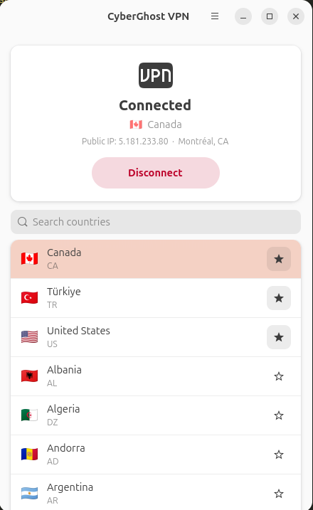

# CyberGhost GUI for Ubuntu

An unofficial GTK4/libadwaita desktop app for connecting to CyberGhost VPN by country.



It uses NetworkManager's OpenVPN plugin, not the official `cyberghostvpn` CLI, because that CLI doesn't support current Ubuntu releases. The connection also appears in GNOME's system menu.

## Install

```bash
./install.sh
```

## First run

1. Sign in at https://my.cyberghostvpn.com → **VPN → Manage Devices → Configure new device**.
2. Choose **OpenVPN** and any country, then download the `.zip`.
3. Open the app, choose the `.zip`, and enter the device **username and password** shown on that page. These are not your account email and password.

After that, pick a country and press **Connect**, or double-click a country. Use the star to pin favourites to the top.

## How it works

- CyberGhost servers are named `87-1-<country>.cg-dialup.net`. The app keeps one NetworkManager connection, "CyberGhost VPN", and changes its server host before each connection.
- At first run it checks which country hostnames exist and caches the result. Use **Menu → Refresh country list** to check again.
- The password is stored in NetworkManager's system connection file, which only root can read.
- After connecting, the app looks up your public IP at ipinfo.io.

## Files

- `~/.config/cyberghost-gui/config.json` holds favourites, the last country and the country cache.
- `~/.local/share/cyberghost-gui/` holds the imported certificates.
